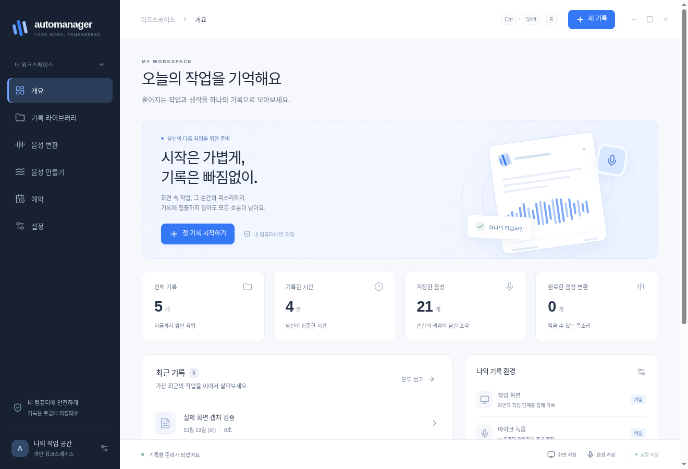

# Automanager

작업 단계, 화면, 주석, 녹음과 음성 변환 결과를 한 타임라인에 보관하는 **Electron + TypeScript 데스크톱 앱**입니다. 한국어 UI를 기본으로 사용하며, 창을 닫으면 트레이에서 기록을 계속합니다.



## 실행

Node.js 24와 npm을 사용합니다.

```sh
npm ci
npm run dev
```

이 클라우드 체크아웃에서는 준비된 가상 화면과 실행 스크립트를 사용합니다.

```sh
npm run start:cloud
```

`Ctrl+Shift+R`로 기록을 시작/종료하고 `Ctrl+Shift+P`로 일시정지/재개합니다. 창의 닫기 버튼은 트레이로 숨깁니다. 프로그램을 완전히 종료하려면 트레이의 **앱 종료**를 사용합니다.

## 구현된 흐름

- 전역 클릭·더블클릭·드래그·스크롤·탐색 키와 단축키를 작업 단계로 기록합니다. 일반 입력 문자열·클립보드·암호 값은 수집하지 않습니다.
- 선택한 화면의 스크린샷과 클릭 표시, 드래그로 선택한 주석 영역을 저장합니다. 마지막 N장 보관 시 오래된 이미지 파일도 제거합니다.
- 별도 캡처 창과 AudioWorklet에서 녹음하고, 저장 프로세스가 독립 재생 가능한 16 kHz mono WAV를 생성합니다. 기본 30초, 선택 15/30/60/120초이며 일시정지·종료 때 마지막 조각을 확정합니다.
- SQLite와 파일 저널로 세션·조각·작업 상태를 보관합니다. 중단된 녹음 복구, 변환 취소·재시도, 작업 세대 검사, 저장 용량 한도를 적용합니다.
- 기록 검색·필터·이름 변경·검토·주석·음성 재생·삭제, HTML/MHTML/JSON과 미디어를 포함한 ZIP 내보내기를 제공합니다. 내보내기는 모든 기록을 종료한 뒤 실행합니다.
- 단발·요일 반복 예약을 제공합니다. 앱이 실행 중이어야 하며, 놓친 예약은 소급 실행하지 않습니다. 로그인 자동 시작은 Windows/macOS 설정만 허용합니다.
- 로컬 `whisper.cpp` 음성 인식, 한국어 `MeloTTS`, 영어 `Kokoro` 음성 합성을 별도 상주 프로세스로 실행합니다. 녹음과 변환은 분리되며 작업 큐는 제한됩니다.

## 음성 엔진과 모델

기본 앱 패키지에는 음성 엔진 연결 코드와 검증된 모델 manifest가 들어 있습니다. 모델과 엔진 런타임은 크기가 커서 별도 로컬 팩으로 준비합니다. 설치되지 않은 모델은 UI에서 미설치 상태로 표시합니다.

Python 3.11/3.12와 C++ 빌드 도구가 있는 머신에서 다음 명령으로 **대상 OS용** 오프라인 팩을 만듭니다. `--portable-python`은 해시를 검증한 독립 Python을 포함하며 추론에 호스트 Python을 쓰지 않습니다.

```sh
python3 scripts/setup-engines.py --directory resources/engines/runtime \
  --portable-python --whisper --python --models whisper-small melo-ko kokoro-en
```

설정의 모델 설치/가져오기와 엔진 실행 파일 선택도 사용할 수 있습니다. Whisper는 `whisper-server` 실행 파일, 한국어/영어 TTS는 준비한 Python 실행 파일을 선택합니다. 한국어 모델은 BERT·tokenizer·발음 자산까지 포함해야 합니다. 자세한 구성과 라이선스는 [음성 엔진 안내](resources/engines/README.md)에 있습니다.

현재 클라우드에는 검증한 portable Python·CPU Whisper·Melo·Kokoro 런타임과 모델이 준비되어 있습니다. 앱은 `resources/engines/runtime`에서 발견한 해당 OS의 팩을 사용합니다. 다른 OS의 바이너리를 준비된 엔진으로 간주하지 않습니다.

## Windows 빌드

지원 대상은 **Windows 10/11 x64**입니다. Windows 7 단계 레코더는 기능 기준이며 Windows 7 호환을 뜻하지 않습니다. 최신 Electron은 Windows 7을 지원하지 않습니다.

Windows의 Visual Studio C++ 개발자 셸에서:

```powershell
npm ci
npm run native:win
npm test
npm run typecheck
npm run package:win -- --x64
```

`.github/workflows/windows.yml`도 MSVC로 Win32/UI Automation Node-API bridge를 빌드하고 NSIS 설치물을 생성합니다. 이 저장소에서 워크플로를 아직 실행하지 않았으며, Linux 검증으로 Windows 동작을 확인했다고 주장하지 않습니다. [네이티브 빌드 안내](native/windows-context/BUILDING.md)를 참고하세요.

Windows 실기기에서 메모장·파일 탐색기의 단계/접근성 설명, 다중 모니터·DPI, 마이크 분리, 트레이 닫기, UAC·잠금 화면 공백, 설치물에서의 addon 로딩을 확인해야 합니다. 일반 앱 권한으로 접근할 수 없는 화면은 기록하지 못합니다. Linux는 X11 전역 입력을 사용하고 창 문맥에 EWMH 창 관리자가 필요합니다. Wayland 전역 입력은 지원하지 않습니다.

## 검증

```sh
npm test
npm run typecheck
npm run build
npm run test:ui
DISPLAY=:99 npm run test:desktop
DISPLAY=:99 node scripts/smoke-screen.mjs
npm run test:speech -- .cache/speech-check/tracker
```

데스크톱 자동화의 마이크 검사는 Chromium 합성 입력을 사용합니다. 125초 동안 제어 창을 닫아도 10개 WAV, 2,005,120 샘플이 저장됐습니다. 재개 후 새 샘플 저장과 독립 WAV 헤더도 확인합니다. 화면은 합성 장치를 끈 별도 검사에서 실제 X11 데스크톱을 캡처했습니다. 실제 하드웨어 마이크의 품질·장치별 동작은 별도 확인이 필요합니다.

실제 로컬 모델 검사에서는 Melo 한국어/af_heart 영어 WAV 생성과 한국어 Whisper 변환을 완료했습니다. 한국어 결과는 `안녕하세요. 오토 매니저는 작업과 음성을 함께 기록합니다.`였습니다. portable Python 이동 후 두 TTS 엔진과 상대 RPATH의 Whisper도 다시 실행했습니다. CPU 처리만 검증했으며 GPU 가속은 이 빌드의 검증 범위에 포함하지 않습니다.

클라우드 실행 스크립트는 이 격리된 테스트 머신의 제한 때문에 Chromium `--no-sandbox` 플래그를 사용합니다. 일반 앱의 renderer는 Node 접근을 끄고, sandbox/contextIsolation·검증된 preload IPC를 사용합니다.

## 파일 구조

`src/main`은 창·트레이·예약·프로세스 감독, `src/capture`는 화면/AudioWorklet/주석, `src/storage`와 `src/workers`는 단일 저장 주체, `src/platform`과 `native/windows-context`는 OS 입력·접근성, `src/engines`는 모델/추론, `src/renderer`는 React UI입니다.

데이터는 기본 Electron 사용자 데이터 폴더 아래 `tracker`에 저장합니다. 클라우드 스크립트는 `/workspace/.cache/automanager-data`를 사용합니다. `AUTOMANAGER_DATA_DIR`로 전체 앱 데이터 위치를 지정할 수 있습니다. 테스트 데이터는 별도의 `.cache` 하위 위치에 보관하며 새 설치의 기록 목록을 채우지 않습니다.
