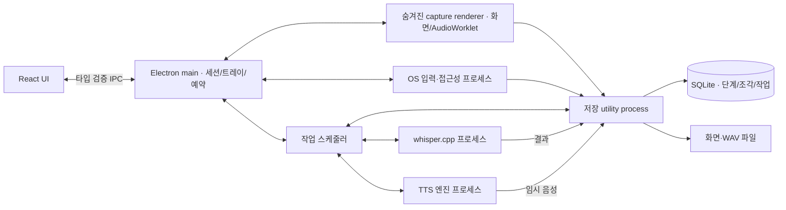

# Automanager 데스크톱 앱 설계 초안

상태: 사용자 검토 전. 이 문서는 구현 목표와 검증 조건이며, 기능 구현 완료 보고서가 아니다.

## 목적과 기본 결정

Automanager는 컴퓨터에서 수행한 작업과 그때의 음성을 함께 되짚어 보는 개인용 종합 트래커다. 사용자가 시작한 기록 세션 안에서 작업 단계, 화면, 주석, 녹음 조각, 음성 변환 결과를 동일한 시간축에 보관한다. 창을 닫아도 기록은 트레이에서 계속된다. 기록을 멈추거나 앱을 종료하는 제어는 항상 제공한다.

요청에 따른 결정:

- 애플리케이션은 Electron + TypeScript로 구현한다. Rust 앱으로 전환하지 않는다.
- Windows 단계 레코더의 기능을 재현하고, 녹음·주기적 조각 저장·로컬 STT·로컬 TTS를 추가한다.
- 기록과 음성 처리는 분리된 프로세스에서 병렬로 실행한다.
- UI는 한국어를 기본으로, Codex의 작업 중심 구조와 Toss의 간결한 조작·타이포그래피를 참고한다. 로고나 기존 앱의 자산을 복제하지 않는다.

현재 정보로 선택한 기본값:

- 우선 배포 대상은 Windows 10/11 x64다. Windows 7은 기능의 참고 대상이다. Electron 22가 Windows 7/8/8.1을 지원한 마지막 버전이므로, 오래된 Electron으로 Windows 7 지원을 약속하지 않는다.
- 현재 개발 환경은 Linux x64, Node 24.19.0, npm 11.9.0이다. Linux에서 공통 로직과 UI를 검증하고, Windows 설치·OS 입력·접근성 기능은 Windows에서 별도 검증한다.
- 로컬 저장과 로컬 엔진을 기본으로 한다. 계정, 서버, 유료 API 키는 필수가 아니다.
- '일정마다 조각 저장'은 연속 녹음을 일정한 길이의 파일로 나누는 기능으로 해석한다. 예약 시작·종료도 별도 일정 기능으로 제공한다.

저장소에는 현재 README만 있다. 기존 앱 코드, 의존성, 실행·테스트 명령은 없다. 이 작업은 신규 앱을 만드는 작업이다.

## 구현 방식 비교

| 방식 | 장점 | 비용과 한계 |
| --- | --- | --- |
| Electron/TypeScript + 별도 로컬 음성 엔진 프로세스 **권장** | 데스크톱 권한·트레이·파일 저장을 지원하고, 음성 엔진 장애가 기록에 영향을 덜 준다. CPU/GPU 네이티브 가속을 사용할 수 있다. | OS별 바이너리와 모델을 함께 관리해야 한다. |
| Electron + 브라우저/WASM 음성 처리 | 자바스크립트 중심으로 배포가 단순해질 수 있다. | 모델 메모리와 처리 성능 부담이 크고, 시스템 입력 수집에는 여전히 OS 연동이 필요하다. |
| Electron + 외부 음성 API | 초기 음성 처리 연결이 빠르다. | 네트워크·키·사용료가 필수이며 오프라인 사용을 충족하지 못한다. 선택 확장으로만 적합하다. |

## 기능 계약

### 작업 단계 레코더

다음 항목은 실제 동작으로 구현한다. 지원되지 않는 OS 기능을 가짜 데이터나 성공 표시로 대체하지 않는다.

| 기능 | Automanager의 동작 |
| --- | --- |
| 시작·일시정지·재개·종료 | 한 세션의 명시적인 상태 전이. 일시정지 동안 새 화면·입력·음성을 수집하지 않는다. |
| 클릭·더블클릭·드래그·탐색 입력 | 전역 입력 어댑터로 단계 생성. 드래그는 시작·끝 좌표를 한 동작으로 묶는다. 인쇄 가능한 키의 내용이나 암호를 저장하지 않는다. |
| 작업 문맥 | 실행 앱, 창 제목, 접근성 요소 이름·종류, 동작 설명, 타임스탬프. 접근성 조회 실패는 '요소 정보 없음'으로 명시한다. |
| 화면 기록 | 선택한 모니터의 단계별 스크린샷. 클릭 위치와 선택한 주석 영역을 표시한다. 다중 모니터와 DPI 배율을 정규화한다. |
| 화면 설정 | 화면 기록 켜기/끄기, 기록할 모니터 선택, 보관할 화면 수 설정. 화면 제한과 별개로 단계 텍스트는 유지한다. |
| 주석 | 기록 중 주석 모드 진입, 사각형 영역 선택, 텍스트 입력. 주석 작성 동안 발생한 앱 내부 입력은 작업 단계로 중복 기록하지 않는다. |
| 검토 | 순서대로 읽기, 화면 크게 보기, 단계 이동, 슬라이드 방식 재생, 세션 이름 변경. |
| 저장·공유 | 세션 내부 파일 보관 및 ZIP 내보내기. 사람이 읽을 HTML/MHTML 보고서, 구조화한 JSON, 화면 파일, 선택한 녹음·텍스트를 포함한다. |
| 원본 Steps Recorder 형식 | MHTML 결과를 제공한다. Microsoft의 내부 XML 형식과 바이트 단위 호환을 주장하지 않는다. Automanager의 구조화 형식과 스키마 버전을 공개한다. |

스크린샷 보관 기본값은 25장으로 하고 사용자가 늘릴 수 있게 한다. 한도 도달 이후의 보관 규칙은 설정에서 '마지막 N장 유지'로 명시한다. 화면이 빠진 단계에도 텍스트·시각·화면 누락 사유를 유지한다.

Windows 구현은 전역 입력 라이브러리와 Windows UI Automation/foreground-window 어댑터를 사용한다. Electron 자체만으로 다른 앱의 접근성 요소를 읽을 수 있다고 가정하지 않는다. 어댑터는 앱이 소유하는 별도 프로세스에 둔다. OS 라이브러리나 오픈소스 엔진이 네이티브 코드인 것은 허용하되 앱의 서비스·UI·IPC는 TypeScript로 작성한다.

전역 입력은 `uiohook-napi`를 사용한다. Windows 문맥 연결은 `native/windows-context`의 작은 Node-API C++ bridge로 Win32 `GetForegroundWindow`, `GetWindowThreadProcessId`, UI Automation COM을 연결한다. 앱 서비스와 UI는 TypeScript로 유지하며 이 코드는 OS 바인딩 역할만 한다. 입력 프로세스에서 즉시 HWND/PID를 확보하고, 별도 접근성 프로세스에서 제어 이름·역할·automation ID와 암호 필드 여부를 조회한다. 입력 hook 콜백에서는 이벤트와 가벼운 창 식별만 큐에 넣고 화면 저장이나 접근성 조회를 기다리지 않는다. `get-windows`는 비 Windows 플랫폼의 지원되는 창 문맥에 사용한다. 네이티브 자원은 ASAR 밖에 패키징하고 라이브러리 라이선스와 Electron ABI 호환성을 의존성 고정 단계에서 확인한다.

각 입력에 event ID, 단조 시각, HWND/PID, 화면 좌표를 고정한다. 지연된 접근성 결과와 화면은 같은 event ID에 연결한다. 창이 사라졌거나 다른 창으로 바뀌면 현재 창의 설명을 과거 이벤트에 잘못 붙이지 않고 문맥 누락/지연을 표시한다. 접근성 프로세스 응답이 2초 넘게 걸리면 해당 조회를 실패로 처리하고 프로세스를 복구한다. Windows feasibility 검사는 메모장·파일 탐색기의 버튼/입력/메뉴, Alt+Tab 직후 클릭, 서로 다른 권한의 창으로 한다.

키보드 단계는 Tab/Shift+Tab, Enter, Escape, 방향·페이지 이동, 기능키 및 Ctrl/Alt/Win 단축키로 제한한다. 문자 키가 포함된 단축키는 조합 이름만 기록하고, 입력 문자열·클립보드·암호 값은 조회하거나 저장하지 않는다.

UAC 보안 화면, 잠금 화면, 보호된 콘텐츠는 일반 프로세스에서 접근하지 못할 수 있다. 해당 구간을 타임라인의 공백으로 표시하고 권한 상승으로 우회하지 않는다. Linux Wayland나 macOS의 캡처·입력 권한은 동일 기능을 보장하지 않으며, OS별 지원 상태를 구분한다.

### 백그라운드와 녹음

- 처음 실행할 때 자동으로 녹음하지 않는다. '기록 시작' 또는 사용자가 설정한 예약으로 세션을 시작한다.
- 메인 창 닫기는 트레이로 숨김이다. 트레이에 기록 상태, 다시 열기, 일시정지/재개, 종료, 앱 종료를 제공한다.
- 녹음용 숨겨진 renderer는 메인 UI 창과 별도 생명주기를 가진다. 백그라운드 타이머 제한을 해제하고 창 최소화·숨김 상태에서도 캡처한다.
- 마이크 선택, 입력 레벨 확인, 녹음 켜기/끄기, 파일 길이 설정을 제공한다. 기본 조각 길이는 30초이고 15·30·60·120초 중 선택한다.
- AudioWorklet로 PCM을 받고 저장 프로세스가 독립적으로 재생 가능한 WAV 파일을 만든다. 16 kHz mono PCM을 STT 입력의 표준으로 삼고, 실제 입력 sample rate를 확인·변환한다.
- MediaRecorder의 timeslice blob을 독립적인 오디오 파일로 간주하지 않는다. 같은 스트림의 연속 샘플을 샘플 수 기준으로 분할하고 누락·중복 없이 저장한다.
- 각 파일에 세션 ID, 연속 번호, 시작 시각, 실제 샘플 길이, 파일 상태를 기록한다. 완성 후 원자적 rename으로 공개하고 완료한 파일만 변환 큐에 넣는다.
- 일시정지는 capture 프로세스의 중단과 저장 프로세스의 flush 확인을 모두 받아 완료한다. 진행 중인 짧은 조각을 그 시점에 확정하고 재개 시 새 조각을 만든다. 한 파일이 일시정지 공백을 가로지르지 않는다.
- 종료 시 마지막 짧은 조각도 확정한다. 저장 중 앱이 중단되면 다음 실행에서 임시 WAV와 저널을 검사해 가능한 샘플을 복구한다.
- 세션 녹음 중 주석·화면 수집·STT·TTS가 함께 실행될 수 있다. TTS 재생은 헤드폰 사용을 안내할 수 있고, 필요하면 녹음 중 재생을 사용자가 끌 수 있다.
- 오디오 장치 분리, 디스크 부족, 캡처 권한 철회는 해당 기능의 오류로 노출한다. 다른 기록 기능이 계속 가능하면 계속하고, 누락 구간과 원인을 남긴다.
- 컴퓨터 절전 중 녹음 지속을 약속하지 않는다. 절전 진입·재개를 타임라인에 남긴다. 잠자기 방지는 기록 중에만 선택적으로 적용한다.
- 예약은 단발·매일·요일 반복, 시작 시각, 종료 시각/길이를 지원한다. 앱이 실행 중일 때 트레이 알림과 함께 시작한다. 놓친 일정은 기록하고 갑자기 소급 녹음을 시작하지 않는다. OS 로그인 시 앱 시작은 별도 설정이다.

### 음성 인식

- 기본 엔진은 MIT 라이선스의 `whisper.cpp`, 기본 모델은 한국어를 포함한 다국어 Whisper `small`이다. 영어 전용 `.en` 모델을 한국어 기본값으로 쓰지 않는다.
- 모델 변경과 언어 선택, 자동 변환 켜기/끄기, 수동 변환·재시도·취소를 제공한다. 처음에는 모델 미설치 상태를 정확히 보여 준다.
- 완료된 조각은 영속 작업 큐에 들어간다. 변환 프로세스는 기록 프로세스와 독립이며, 초기 STT 동시 실행 수는 1이다. 추가 병렬 작업은 제한된 큐를 통해 처리한다.
- CPU 실행을 항상 제공하고 GPU 가속은 배포 바이너리와 기기에서 실제 지원되는 백엔드만 선택한다. 모든 PC에서 GPU 또는 실시간 변환을 보장하지 않는다.
- 모델을 매 조각마다 다시 읽지 않도록 상주 엔진 프로세스를 사용한다. `whisper.cpp`는 대상 OS용 바이너리를 빌드·검증해 제공하며, 다운로드 가능한 최신 공식 실행 파일이 항상 있다고 가정하지 않는다. CPU thread 수와 GPU 동시 사용량을 제한해 화면·녹음 처리를 위한 자원을 남긴다.
- 결과는 조각에 대한 상대 시각을 세션 시각으로 변환해 연결한다. 원문을 보존하면서 조각 경계에 걸친 문장은 UI에서 이어 읽을 수 있게 한다. 오디오와 텍스트가 자동 삭제되거나 임의로 합쳐져 손실되지 않게 한다.
- 엔진은 실행 경로와 타입을 허용 목록으로 제한하고 인자를 배열로 전달한다. 사용자 입력을 셸 명령으로 연결하지 않는다.
- 긴 처리, 취소, 실패, 재시작 후 복구, 재시도로 생기는 중복 결과를 모두 큐 상태로 처리한다.

### TTS와 엔진 관리

- 한국어를 포함한 실제 합성 엔진을 연결하고, 텍스트 입력→음성 생성→재생→WAV 저장의 전체 흐름을 제공한다.
- 한국어 기본 엔진은 MIT 라이선스의 `MeloTTS-Korean` 상주 프로세스로 정한다. 앱 자체는 Electron/TypeScript이며, 음성 엔진에 필요한 고정 Python/PyTorch 런타임은 별도 엔진 구성 요소로 관리한다. 체크포인트뿐 아니라 config, 한국어 G2P, tokenizer, Apache-2.0 한국어 BERT 자산을 준비하고 네트워크를 차단한 상태에서도 실제 합성이 되는지 확인한다. 체크포인트 약 208 MB와 BERT 약 476 MB 외에 런타임 용량이 필요하므로 설치 전에 전체 용량을 표시한다. 품질·지연은 실제 한국어 검증 음성으로 평가한다.
- 추가 로컬 TTS로 `sherpa-onnx`의 Kokoro 지원을 연결하고, 공개 모델이 지원하는 영어 등 언어에 사용한다. 현재 공개 언어 목록에 없는 한국어 지원을 주장하지 않는다. 엔진별 음성을 동일한 UI에서 선택할 수 있게 한다. `Piper`는 추후 교체 가능한 엔진 어댑터로 남기되 초기 설치의 필수 조건으로 만들지 않는다.
- 경량 한국어 대안 `vits-mimic3-ko_KO-kss_low`는 실제 공개 ONNX 변환물과 CC0 원본 음성 카드가 있다. 그러나 원본이 낮은 품질 모델이라고 명시하므로 기본 음성 대신 경량 선택지로만 다룬다. 존재하지 않는 sherpa용 Melo 한국어 변환물이 있다고 가정하지 않는다.
- `sherpa-onnx` 엔진 본체의 Apache-2.0과 별개로, TTS 빌드의 eSpeak NG GPL 의무를 배포 구성에 반영한다. `Kokoro` 코드·가중치의 Apache-2.0만 보고 전체 바이너리가 그 라이선스라고 표시하지 않는다. 필요한 라이선스·소스 제공 방법을 배포물에 포함한다.
- 엔진과 모델은 구분해서 관리한다. 각각 버전, 출처, 라이선스, 언어, 용량, SHA-256, 플랫폼·아키텍처를 manifest에 기록한다.
- 모델은 기본·경량 설치 패키지를 선택해 내려받거나 사용자가 이미 가진 모델을 가져올 수 있다. 기본 한국어 TTS의 큰 런타임을 포함해 패키지별 전체 용량을 표시한다. 모든 모델을 앱 설치 파일에 무조건 포함하지 않는다. 실행 가능한 기본 엔진은 패키지에 동봉하거나 검증된 설치 경로로 준비한다.
- 다운로드는 TLS 검증을 유지하고 고정 revision·검증된 해시를 사용한다. 중단된 다운로드는 완료 상태로 표시하지 않는다. 라이선스 고지와 필요한 소스 제공 의무는 배포물에 포함한다.
- 오프라인 모델 설치 후에는 음성 처리에 네트워크가 필요하지 않다. 인터넷이 필요한 다운로드와 실제 로컬 추론을 UI에서 구분한다.

## 프로세스와 데이터 흐름

모든 기능을 무제한 프로세스로 만드는 대신, 캡처·저장·음성 추론을 독립적으로 운영한다. 파일 저장은 스트림별 순서를 보장하고 큐는 메모리 상한을 둔다. 느린 작업은 기록을 블로킹하지 않는다. 용량 한계 때문에 기록을 더 받을 수 없으면 숨기지 않고 해당 기록을 명시적으로 중단한다.

기본 자원 정책:

- 오디오 IPC는 최대 250 ms 단위로 보내고 ACK를 받는다. 미저장 PCM은 최대 4초를 보관한다. 상한 도달 시 녹음을 명시적으로 중단하고 저장된 부분을 확정한다. 이미 만든 조각은 유지한다.
- 화면 요청은 최대 4개, 이미지 전송 큐는 최대 32 MiB로 제한한다. 초과한 화면은 누락 사유를 단계에 남기고 텍스트 단계는 보관한다.
- 실행 가능한 작업은 DB에서 필요한 수만 읽는다. STT 1개와 TTS 1개를 기본 최대 병렬 수로 하고, 동시에 사용하는 TTS 모델은 1개다.
- 추론 메모리 예산은 시작 시 가용 메모리의 60%, 최대 8 GiB로 한다. 모델별 예상 peak memory와 실행 중 실제 사용량으로 추가 로딩을 허용한다. 예산이 부족하면 유휴 엔진을 내리고 작업을 대기시킨다. 녹음·저장은 엔진 로딩보다 우선한다.
- 저장 공간은 기본 10 GiB 기록 한도, 파일시스템 여유 공간 최소 512 MiB를 적용하고 사용자가 기록 한도를 늘릴 수 있게 한다. 기존 세션을 임의로 삭제해서 공간을 만들지 않는다. 한도 도달 시 저장을 확정하고 기록을 중단한다. 모델 다운로드도 여유 공간 검사를 먼저 수행한다.
- 마지막 N장 정책은 이전 이미지의 DB 참조를 제거한 뒤 실제 파일을 제거한다. 파일 제거 실패는 정리 대상으로 남기고 총 디스크 사용량에 포함한다.

공유 IPC 계약은 세션 상태, 단계, 조각, 모델, 작업, 설정의 discriminated union과 런타임 검증 스키마로 정의한다. API는 최소한의 명령만 preload의 `contextBridge`로 노출한다. UI renderer에 Node 접근, 임의 파일 읽기, 임의 프로세스 실행을 열지 않는다.

SQLite는 WAL, migration, 외래 키를 사용한다. 세션/이벤트/오디오 조각/STT 구간/작업/설정/일정을 별도로 저장한다. 저장 utility process가 유일한 DB 쓰기·완성 파일 공개 주체이고 UI·스케줄러·엔진은 그 API를 사용한다. 엔진은 작업별 임시 위치에만 결과를 쓰며 저장 프로세스가 검증 후 공개한다. 파일 경로는 내부 ID로 해결하고 세션 저장 루트 밖의 파일을 IPC로 지정하지 못하게 한다.

파일 확정은 pending metadata 등록→임시 파일 쓰기→헤더/내용 flush·fsync→rename→ready 상태와 후속 job 생성의 DB transaction 순서다. 파일시스템과 DB를 하나의 원자적 transaction이라고 가정하지 않는다. 재시작에서 각 단계 사이의 종료를 탐지하고, 유효한 완성 파일은 메타데이터와 재연결하며, 미완료 파일은 가능한 샘플로 확정한다. 참조 없는 파일은 격리 후 복구하고 손상된 파일은 성공으로 표시하지 않는다. `(session ID, stream ID, sequence)`와 `(artifact ID, engine version, generation)`에 고유성을 두어 중복 조각·결과·작업을 막는다. 삭제·취소 이후 도착한 이전 generation의 결과는 적용하지 않는다.

시간 원점은 main이 세션 시작 때 정한 monotonic origin이며 각 프로세스는 시작 handshake로 그 시간축에 맞춘다. 오디오 첫 샘플의 시각과 샘플 번호를 기준으로 구간을 계산하고 wall clock은 표시·예약에만 사용한다. IPC 지연으로 인한 동기 오차는 측정하고 25 ms를 넘는 경우 표시한다. STT 상대 시각도 해당 오디오 원점으로 변환한다. 일시정지·절전 공백을 실제 기록 시간으로 메우지 않는다.

삭제는 세션 관련 오디오·화면·텍스트·대기 작업을 모두 대상으로 한다. 실행 중 작업 취소·파일 해제 후 제거하고 실패한 삭제는 표시한다. 내보내기는 선택한 세션과 선택한 데이터 종류만 포함한다.

## UI 계약

- 왼쪽 탐색: 개요, 기록 라이브러리, 음성 변환, 음성 만들기, 예약, 설정.
- 개요: 현재 기록 상태와 큰 시작/종료 버튼, 최근 기록, 큐 상태. 아직 기록이 없으면 실제 빈 상태와 시작 안내를 보여 준다.
- 기록 화면: 시간·단계 수·녹음 상태를 상단에 고정하고, 가운데 타임라인, 오른쪽 화면/주석/음성/텍스트 상세를 제공한다. 작은 창에서는 상세를 별도 패널로 전환한다.
- 라이브러리: 날짜·앱·음성 변환 상태·검색어로 필터하고, 이름 변경·열기·내보내기·삭제를 제공한다.
- 음성 변환: 대기·진행·완료·실패를 구분하고 원래 녹음과 연결한다. 실패 이유와 재시도 제어를 제공한다.
- 음성 만들기: 언어·음성·속도·텍스트, 생성 진행 상태, 플레이어와 저장 제어. 설치하지 않은 모델은 설치 동작으로 연결한다.
- 설정: 마이크·모니터·조각 길이·화면 한도·저장 위치·엔진/모델·백그라운드/로그인 시작·단축키. 실제 지원되지 않는 옵션은 이유를 표시한다.
- 밝은 중립 배경, 파란 주동작, 넓은 여백, 얇은 구분선, 명확한 숫자와 문장형 상태를 사용한다. 색상만으로 기록 상태를 표현하지 않는다.
- 키보드 탐색, 가시적 포커스, 접근성 이름, 적절한 대비, 모션 감소 설정을 지원한다. 기본 기록 단축키는 Ctrl+Shift+R, 일시정지는 Ctrl+Shift+P이며 충돌 시 재설정을 안내한다.

## 개발·배포 구조

예상 책임 경계:

- `src/shared`: 데이터 스키마와 IPC 계약.
- `src/main`: 창·트레이·권한·프로세스 감독·예약.
- `src/capture`: 화면과 오디오 수집, 주석 overlay.
- `src/workers`: 순차 저장·복구·내보내기.
- `src/platform`: OS 입력/창/접근성 어댑터와 기능 상태.
- `src/engines`: 모델 manifest·검증·STT/TTS 프로세스 연결·작업 큐.
- `src/renderer`: React UI와 상태 관리.
- `tests`: 저장·상태 전이·엔진·UI 통합 테스트와 실제 기기 검사 절차.

Electron + React + Vite + TypeScript, SQLite, Vitest, Playwright를 기본으로 한다. Electron 패키징 도구로 Windows 설치물과 Linux 검증용 빌드를 만들고 OS별 네이티브 의존성은 대상 Electron ABI에 맞춰 준비한다. 라이브러리와 모델 버전은 실제 설치 시 고정하고 lockfile을 저장한다.

기존 클라우드 체크아웃 `/workspace/automanager`를 사용한다. 별도 Git worktree는 필요하지 않다. 일반 앱 코드 구현은 사용자가 요청한 별도 개발 작업이고, 환경 온보딩의 '코드 변경 없이 설정' 제한을 앱 개발 금지로 확대하지 않는다.

## 구현 완료로 인정할 검증

1. 앱 실행과 패키지 생성, TypeScript 검사가 통과한다.
2. 기록 시작→클릭·드래그·주석→일시정지→재개→종료가 저장되고 재실행 후 동일하게 조회된다.
3. 실제 Windows 앱에서 단계, 창 문맥, 화면, 주석, 다중 모니터 좌표를 확인한다. 권한 없는 화면의 공백 표기도 확인한다.
4. 메인 창을 닫은 상태에서 2분 이상 녹음하고 트레이로 제어한다. 조각 파일 각각이 독립 재생되고 총 샘플 수에 분할로 인한 손실·중복이 없다.
5. STT/TTS를 실행하는 동안 기록이 유지된다. 프로세스 하나를 종료해도 다른 기능이 계속되고 작업 재시도가 가능하다.
6. 실제 한국어 음성 파일을 설치한 모델로 변환하고 결과가 해당 조각·시각에 연결된다. 빈 파일이나 mock 결과로 성공 판정을 하지 않는다.
7. 실제 TTS 모델로 소리를 생성·재생·저장한다. 한국어 음성은 한국어 텍스트로 별도 확인한다.
8. 앱 강제 종료·재실행에서 완료 조각·큐가 복원되고 가능한 미완료 녹음이 복구된다. 종료 시 마지막 짧은 조각도 남는다. 파일 확정의 각 단계 사이에 중단을 주입하고 중복 조각·job·결과가 없는지 확인한다.
9. 장치 분리, 권한 거부, 디스크 부족, 모델 없음, 엔진 실패를 재현하고 정확한 상태와 복구 제어를 확인한다.
10. 내보낸 ZIP을 해제하고 화면·텍스트·녹음·MHTML을 읽는다. 포함·제외 선택과 세션 삭제의 적용 범위를 확인한다.
11. 예약과 시간대·일광 절약 시간 변화·놓친 일정 처리를 테스트한다.
12. 느린 저장·지속적인 음성 변환 backlog·추론 메모리 부족을 주입해 큐 상한과 녹음 보호 동작을 확인한다. 스크린샷 한도는 표시만 줄이는 것이 아니라 실제 파일 수와 디스크 사용량으로 확인한다.
13. 개발 Linux에서 확인한 결과, Windows 실기기에서 확인한 결과, 확인하지 못한 항목을 완료 보고서에서 분리한다. Windows 설치물을 만들었다는 사실만으로 Windows 동작 검증을 주장하지 않는다.

## 현재 확인한 사실과 후속 경계

- 체크아웃은 원격 main의 최초 커밋 `3b69e39f45d983c8f72774032d97ec774e7942a2`와 일치한다. 설계 전에는 변경 파일이 없었다.
- 앱 코드·의존성 설치·실행·음성 모델 검증은 아직 하지 않았다. 이번 단계에서는 구조와 기술 선택을 검토한다.
- Windows 장치·마이크·GUI가 있는 검증 환경은 현재 확인되지 않았다. OS 기능이 포함된 완료 판단에는 Windows 검증 결과가 필요하다.
- 설계 승인 다음 단계는 파일·인터페이스·테스트·작업 순서를 구체화한 구현 계획 작성이다. 그 계획의 검토와 실행 방법 선택을 거쳐 구현한다.

## 근거

- Electron Windows 7 지원 종료: https://www.electronjs.org/blog/windows-7-to-8-1-deprecation-notice
- Microsoft 단계 레코더 설명: https://support.microsoft.com/en-us/windows/apps/steps-recorder-deprecation
- 이전 단계 레코더 화면 한도: https://learn.microsoft.com/en-us/answers/questions/2646086/problem-step-recorder-problem-only-captures-first
- Electron 화면 캡처: https://www.electronjs.org/docs/latest/api/desktop-capturer
- Electron utility process: https://www.electronjs.org/docs/latest/api/utility-process
- Electron 창/백그라운드 동작: https://www.electronjs.org/docs/latest/api/browser-window
- MediaRecorder 데이터 조각 계약: https://www.w3.org/TR/mediastream-recording/
- whisper.cpp: https://github.com/ggml-org/whisper.cpp
- Whisper 코드·모델 라이선스: https://github.com/openai/whisper
- sherpa-onnx: https://github.com/k2-fsa/sherpa-onnx
- 공개 ONNX TTS 모델: https://github.com/k2-fsa/sherpa-onnx/releases/tag/tts-models
- 한국어 음성 원본 라이선스: https://github.com/MycroftAI/mimic3-voices/blob/master/voices/ko_KO/kss_low/LICENSE
- 한국어 MeloTTS 모델: https://huggingface.co/myshell-ai/MeloTTS-Korean
- MeloTTS 한국어 자산 의존성: https://github.com/myshell-ai/MeloTTS/blob/main/melo/text/korean.py
- 한국어 BERT 원본 라이선스: https://github.com/kiyoungkim1/LM-kor#license
- Kokoro: https://huggingface.co/hexgrad/Kokoro-82M
- Piper: https://github.com/OHF-Voice/piper1-gpl
- 전역 입력: https://github.com/SnosMe/uiohook-napi
- 활성 창 정보: https://github.com/sindresorhus/get-windows
- Windows UI Automation 권한: https://learn.microsoft.com/en-us/windows/win32/winauto/uiauto-securityoverview
